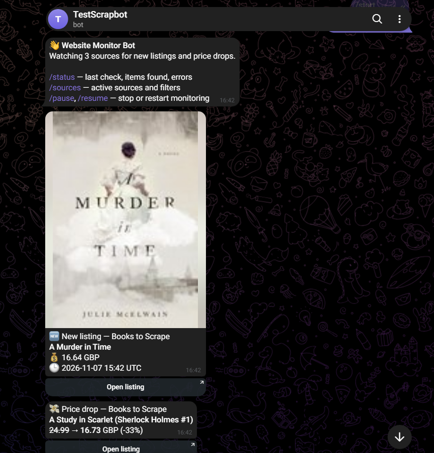
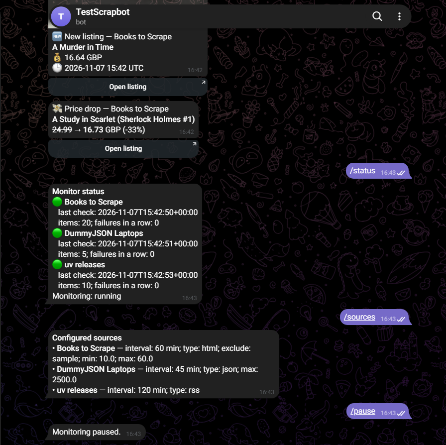

# Website Monitor Bot

A Python bot that watches listing and product pages, RSS feeds and JSON APIs. It sends a Telegram alert when a new item appears or a price drops. Each source is one block in a YAML file, so you can add a new site without changing any code.

<p>
  
  
</p>

## Problem → Solution → Result

**Problem.** Good deals and new listings go fast. If you check a dozen sites by hand several times a day, you lose hours and still miss things. Most "page change" tools also send every small edit, or flood you with old items the first time they run.

**Solution.** An async Python service that:

- fetches each source on its own schedule (HTML with CSS selectors, RSS/Atom, or JSON APIs; it can render JavaScript pages with headless Chromium),
- turns every result into one standard item (title, price, currency, URL, image),
- remembers every item in SQLite, so it only alerts on things that are actually new or cheaper,
- applies keyword and price filters before it sends anything to Telegram.

**Result.**

- New items reach Telegram within one check interval.
- The first run is silent, and restarts never create duplicate alerts.
- One broken site doesn't stop the others. When a source fails 3 times in a row, the admin gets an alert, and another one when it recovers.
- Adding a site takes about 10 lines of YAML.

## Features

- **Three source types:** `html` (CSS selectors, with `::attr(name)` to read attributes), `rss` (RSS/Atom), `json` (dot paths plus a `link_template` for APIs without a URL field)
- **Optional Playwright** for JavaScript-rendered pages: `use_browser: true` on a single source
- **Smart deduplication:** each item ID is the SHA-256 of its absolute URL. The first run of a source only saves the current items (baseline), and **New listing** / **Price drop** alerts start from the next check
- **Filters per source:** `include_keywords`, `exclude_keywords`, `min_price`, `max_price`
- **Polite by default:** per-source intervals with 10–30% random jitter, honest User-Agent, `robots.txt` is checked
- **Reliable:** timeouts, 3 retries with exponential backoff, alerts when a source fails and when it recovers, a rate-limited Telegram queue (~1 message per second), photo alerts that fall back to text
- **Admin commands:** `/start`, `/status`, `/sources`, `/pause`, `/resume`. Only `ADMIN_CHAT_ID` can use them
- **Deployment:** Docker Compose, SQLite in a named volume, logs to stdout
- **Tested:** 35 pytest tests (parsers on a saved HTML page, filters, deduplication across restarts, price drops, failure alerts, message format)

### Alert format

```
🆕 New listing — Books to Scrape
A Murder in Time
💰 16.64 GBP
🕒 2026-11-05 18:53 UTC
[ Open listing ]
```

```
💸 Price drop — Books to Scrape
A Study in Scarlet (Sherlock Holmes #1)
24.99 → 16.73 GBP (-33%)
[ Open listing ]
```

## Quick start

1. **Create a bot.** Open [@BotFather](https://t.me/BotFather), send `/newbot` and copy the token.
2. **Configure.**

   ```sh
   cp .env.example .env              # then put BOT_TOKEN into .env
   cp sources.example.yaml sources.yaml   # optional: without it the examples are used
   ```

3. **Find your chat ID.** Send `/start` to your bot, then run:

   ```sh
   uv run python -m app.whoami       # or: docker compose run --rm monitor python -m app.whoami
   ```

   Put the ID into `CHAT_ID` (where alerts go) and `ADMIN_CHAT_ID` (who may use commands). They can be the same.

4. **Run.**

   ```sh
   docker compose up -d --build
   docker compose logs -f
   ```

The first check of each source saves a baseline and sends nothing. From then on you only get alerts for new items and price drops.

### Environment variables

| Variable | Required | Description |
|---|---|---|
| `BOT_TOKEN` | yes | Telegram bot token |
| `CHAT_ID` | yes | Chat that receives alerts (user, group or channel) |
| `ADMIN_CHAT_ID` | yes | Chat allowed to run commands; gets failure/recovery alerts |
| `DB_PATH` | no | SQLite path (default `data/monitor.db`, `/data/monitor.db` in Docker) |
| `LOG_LEVEL` | no | `INFO` (default), `DEBUG`, `WARNING`, `ERROR` |
| `SOURCES_PATH` | no | Sources file (default `sources.yaml`, falls back to `sources.example.yaml`) |
| `USER_AGENT` | no | User-Agent sent to websites |
| `INSTALL_BROWSER` | no | `true` builds the image with Chromium for `use_browser` sources |

## Adding a source

Add a block to `sources.yaml` and restart with `docker compose up -d --build`.

```yaml
sources:
  - name: Books to Scrape
    url: https://books.toscrape.com/catalogue/category/books/mystery_3/index.html
    type: html                    # html | rss | json
    interval_minutes: 60
    use_browser: false            # true = headless Chromium for JS-rendered pages
    selectors:                    # relative to each item card
      item: article.product_pod
      title: "h3 a::attr(title)"  # ::attr(name) reads an attribute instead of text
      link: h3 a                  # href by default
      price: p.price_color
      image: div.image_container img
    currency: GBP                 # used when the price text has no currency sign
    filters:
      include_keywords: []        # any of these must be in the title
      exclude_keywords: ["sample"]
      min_price: 10
      max_price: 60
```

A JSON API: `item_path` points to the list, and `fields` are paths inside each record.

```yaml
  - name: DummyJSON Laptops
    url: https://dummyjson.com/products/category/laptops
    type: json
    interval_minutes: 45
    item_path: products
    fields:
      title: title
      price: price                # nested paths work too: pricing.amount, images.0
      image: thumbnail
      link_template: "https://dummyjson.com/products/{id}"   # or `link: url`
```

An RSS or Atom feed needs only `name`, `url`, `type: rss` and `interval_minutes`.

How to find selectors: open the page, right-click an item card → **Inspect**, and pick a class that every card shares (`item`). Then pick selectors for the title, link, price and image inside the card. If the page finds 0 items, the check counts as a failure, so broken selectors show up in `/status`.

## Bot commands

| Command | What it does |
|---|---|
| `/start` | Greeting and command list |
| `/status` | Each source: last check, stored items, failures in a row, last error |
| `/sources` | Active sources with interval, type and filters |
| `/pause` / `/resume` | Stop / restart monitoring |

## Development

Requires [uv](https://docs.astral.sh/uv/). Python 3.12 is installed automatically.

```sh
uv sync
uv run pytest                     # 35 tests
uv run python -m app.main         # run locally with .env
uv run playwright install chromium  # only for use_browser sources
```

```
app/
  main.py          entry point: bot polling + scheduler, graceful shutdown
  config.py        .env settings (pydantic-settings) and sources.yaml schema
  scheduler.py     per-source loop with jitter; fetch → parse → store → notify
  fetchers/        http.py (httpx, retries, robots.txt), browser.py (Playwright)
  parsers/         html.py, rss.py, json.py → common Item model
  storage.py       SQLite: items, baseline, price history, source health
  filters.py       keyword and price filters
  notifier.py      rate-limited Telegram queue and message formatting
  bot_commands.py  admin-only commands
  whoami.py        prints chat IDs that messaged the bot
tests/             pytest suite + saved HTML fixtures
```

## Responsible use

**Monitor only public pages, and respect each site's terms of service and robots.txt.** Keep the intervals reasonable. The bot checks `robots.txt` by default (`respect_robots: true`). Don't use it on pages that need a login, and don't use it to get around anti-bot protection.

## License

MIT
